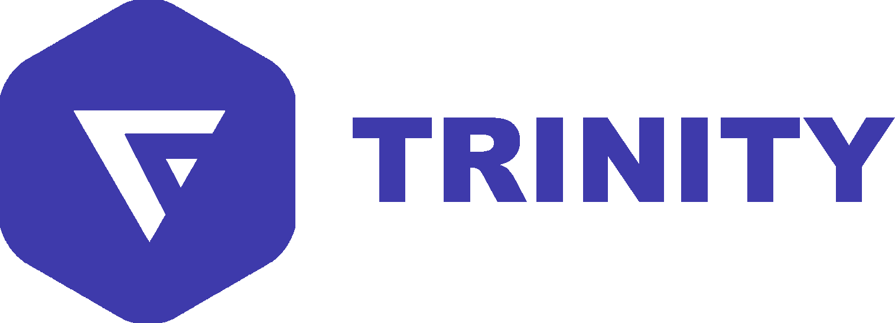
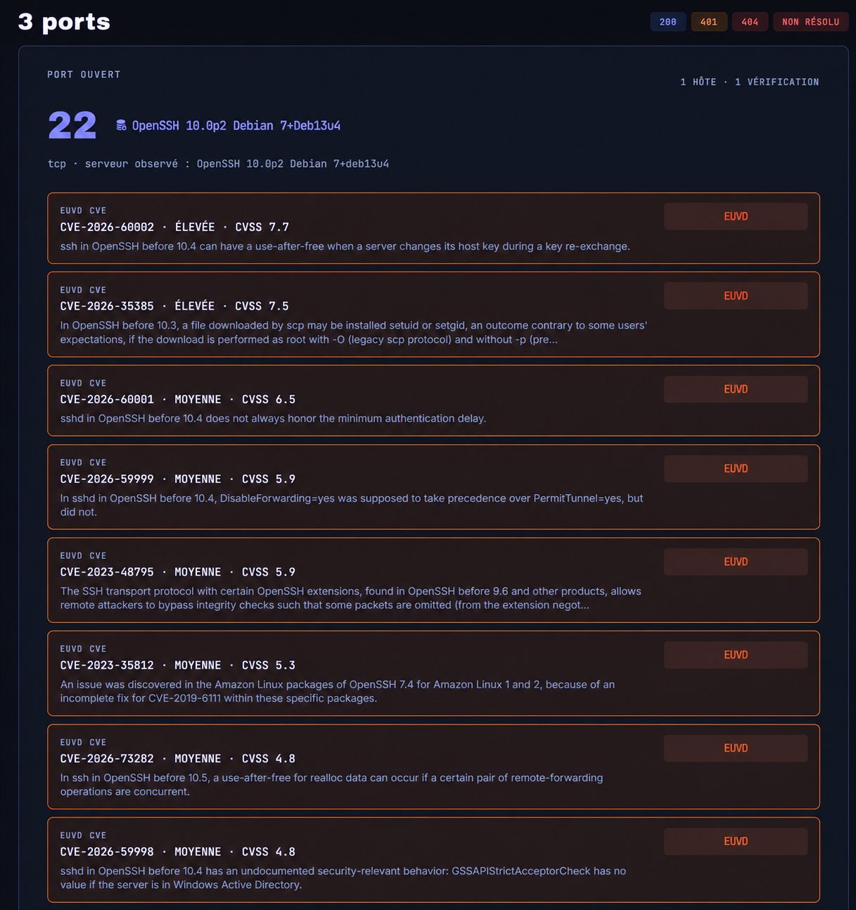
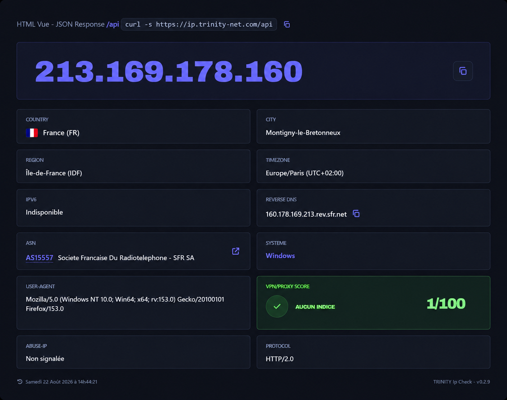
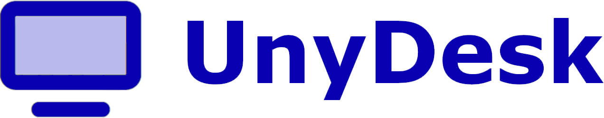
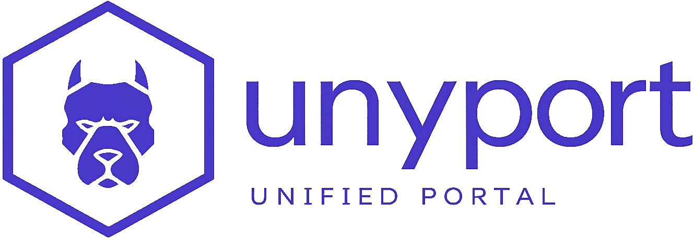
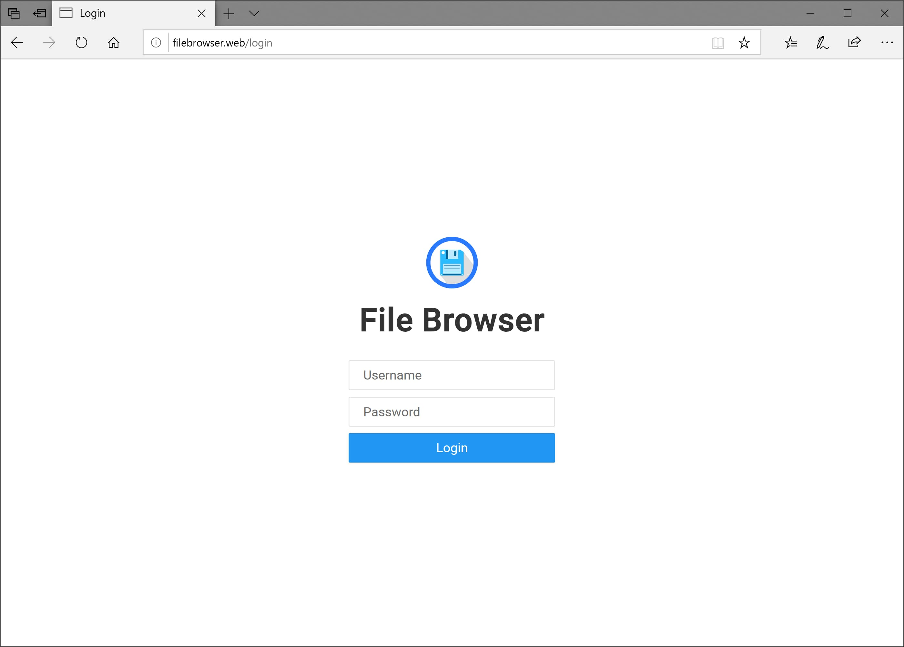

# TRINITY
- ✅ Vor einer Anleitung das zum Bedarf passende Produkt auswählen.

- ⭕ Niemals Token, Geheimnisse oder Sitzungswerte in einem Bericht veröffentlichen.

- ➡️ Die wichtigsten öffentlichen Oberflächen prüfen:

```bash
curl -fsSI https://trinity-net.com/
curl -fsS https://ip.trinity-net.com/api | jq .
```

## Dokumentierte Produkte

<div class="unyport-icon-grid">
  <figure class="trinity-home-logo"><figcaption><a href="trinity/">TRINITY</a></figcaption></figure>
  <figure><figcaption><a href="scan/">Scan / Audit</a></figcaption></figure>
  <figure><figcaption><a href="ip/">IP</a></figcaption></figure>
  <figure><figcaption><a href="unydesk/">UnyDesk</a></figcaption></figure>
  <figure><figcaption><a href="unyport/">UnyPort</a></figcaption></figure>
  <figure><figcaption><a href="unycloud/">UnyCloud</a></figcaption></figure>
</div>
`TRINITY` ist die zentrale Architektur der Plattform.

Sie ist die wichtigste öffentliche Oberfläche für:

- Identität und Kontozugriff
- Bestell- und Provisionierungsabläufe
- Orchestrierung des VM-Lebenszyklus
- Konsolenzugriff
- Veröffentlichung kuratierter Downloads

Im öffentlichen Dokumentationsbestand wird `TRINITY` zusammen mit den beiden ergänzenden Architekturen dokumentiert, die die Plattform vervollständigen:

- `UnyDesk` Für den Fernzugriff
- `UnyPort` Für die Service-Steuerung

Diese Dokumentation beginnt mit `TRINITY`, weil es das funktionale Zentrum der Plattform ist, nicht weil die anderen Architekturen zweitrangig wären.
