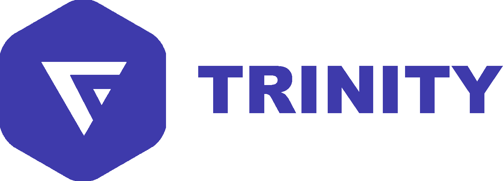
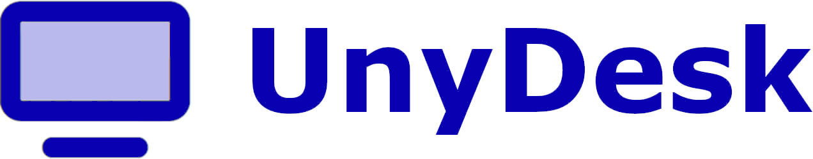
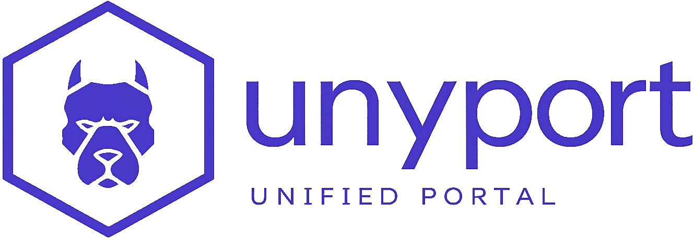
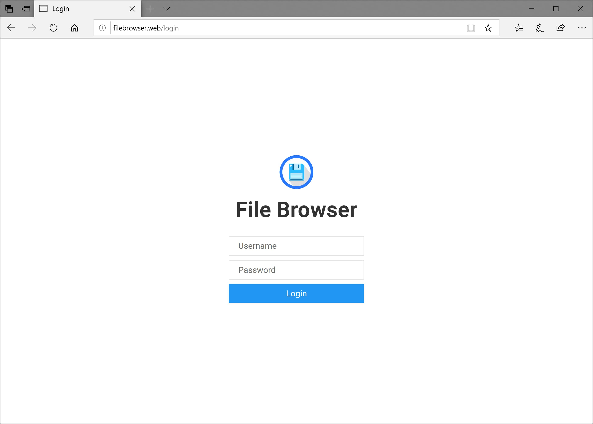

# TRINITY
✅ Select the product that matches the need before following a procedure.

⭕ Never publish a token, secret or session value in a report.

➡️ Check the essential public surfaces:

```bash
curl -fsSI https://trinity-net.com/
curl -fsS https://ip.trinity-net.com/api | jq .
```

## Documented products

<div class="unyport-icon-grid">
  <figure><figcaption><a href="trinity/">TRINITY</a></figcaption></figure>
  <figure><figcaption><a href="scan/">Scan / Audit</a></figcaption></figure>
  <figure><figcaption><a href="ip/">IP</a></figcaption></figure>
  <figure><figcaption><a href="unydesk/">UnyDesk</a></figcaption></figure>
  <figure><figcaption><a href="unyport/">UnyPort</a></figcaption></figure>
  <figure><figcaption><a href="unycloud/">UnyCloud</a></figcaption></figure>
</div>
`TRINITY` is the central architecture of the platform.

It is the main public surface for:

- ✅ Identity and account access
- ✅ Order and provisioning flows
- ✅ VM lifecycle orchestration
- ✅ Console access
- ✅ Curated download publication

In the public documentation set, `TRINITY` is documented alongside the two companion architectures that complete the platform:

- ✅ `UnyDesk` For remote access
- ✅ `UnyPort` For service control

This documentation starts from `TRINITY` because it is the functional center of the platform, not because the other architectures are secondary.
