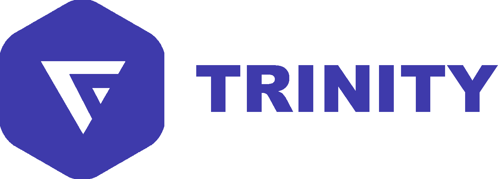
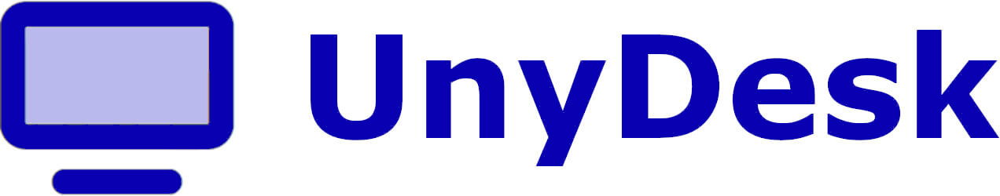
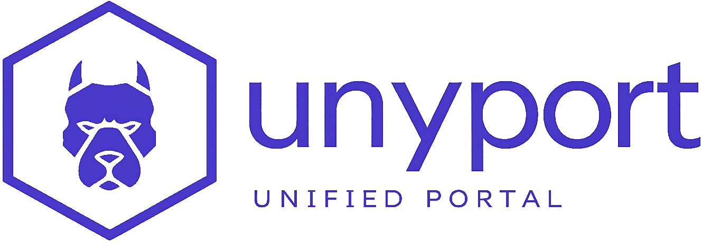
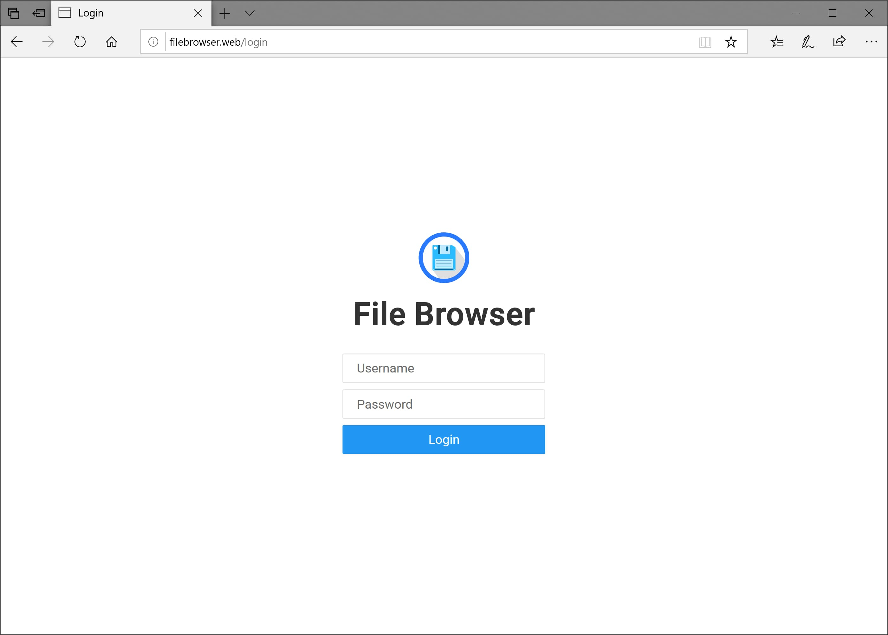

# TRINITY
✅ Choisir le produit correspondant au besoin avant de suivre une procédure.

⭕ Ne jamais publier de jeton, secret ou donnée de session dans un rapport.

➡️ Vérifier les surfaces publiques essentielles :

```bash
curl -fsSI https://trinity-net.com/
curl -fsS https://ip.trinity-net.com/api | jq .
```

## Produits documentés

<div class="unyport-icon-grid">
  <figure><figcaption><a href="trinity/">TRINITY</a></figcaption></figure>
  <figure><figcaption><a href="scan/">Scan / Audit</a></figcaption></figure>
  <figure><figcaption><a href="ip/">IP</a></figcaption></figure>
  <figure><figcaption><a href="unydesk/">UnyDesk</a></figcaption></figure>
  <figure><figcaption><a href="unyport/">UnyPort</a></figcaption></figure>
  <figure><figcaption><a href="unycloud/">UnyCloud</a></figcaption></figure>
</div>
`TRINITY` est l'architecture centrale de la plateforme.

Elle constitue la surface publique principale pour :

- ✅ L'identité et l'accès aux comptes
- ✅ Les flux de commande et de provisionnement
- ✅ L'orchestration du cycle de vie des VM
- ✅ L'accès console
- ✅ La publication de téléchargements préparés

Dans le corpus public, `TRINITY` est documentée aux côtés des deux architectures complémentaires qui complètent la plateforme :

- ✅ `UnyDesk` Pour l'accès distant
- ✅ `UnyPort` Pour le pilotage des services

Cette documentation commence par `TRINITY` parce qu'elle est le centre fonctionnel de la plateforme, pas parce que les autres architectures seraient secondaires.
