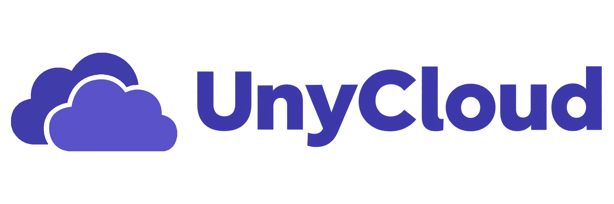
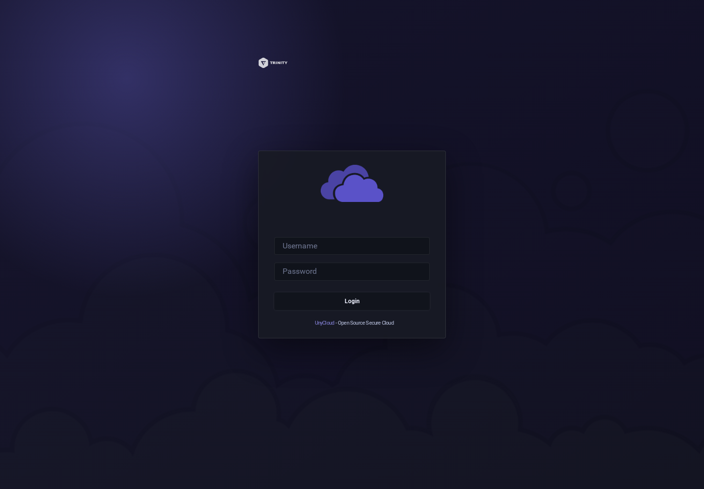

# UnyCloud
{ .project-root-logo }

## Aktuelle Oberfläche

{ .unyport-screen }

- Vor jedem Upload Datei und Ziel prüfen.
- ⭕ Einen Freigabelink widerrufen, sobald er nicht mehr benötigt wird.
- ➡️ Den von der Cloud-Oberfläche gelieferten Inhaltstyp prüfen:
```bash
curl -fsSI https://cloud.trinity-net.com/
```
`UnyCloud` ist der Cloud-Bereich von Ökosystem-Dateien `TRINITY`Es entblößt `<cloud-domain>` als Browserspace, Repository, Download und Filesharing, während man sich auf eine gepflegte Filebrowser-Fork verlässt.

öffentlich, `UnyCloud` führt zusammen:

- Eine Webfile-Schnittstelle
- Authentifizierter Zugang zu montierten Räumen
- Eine dedizierte Branding-Trinity
- HTTPS-Einstiegspunkt hinter Reverse Proxy
- Klare Trennung zwischen sichtbarem Produkt und Laufzeit Filebrowser

`UnyCloud` muss als Cloud-Benutzerdienst gelesen werden. `Filebrowser` bleibt die technische Abstammung und der dokumentierte Kompatibilitätsvertrag auf der Admin-Seite.

## Beginnen Sie hier
Empfohlene Bestellung:

1. ➡️ `Introduction`
2. ➡️ `Présentation`
3. ➡️ `Architecture`
4. ➡️ `Mode d'emploi`
5. ➡️ `Accès et authentification`
6. ➡️ `Déploiement`
7. ➡️ `Sécurité et exploitation`
8. ➡️ `Exemples`
9. ➡️ `Historique`

```text
Navigateur
  -> <cloud-domain>
  -> Reverse proxy TRINITY
  -> Runtime Filebrowser
  -> Stockage monté
```
