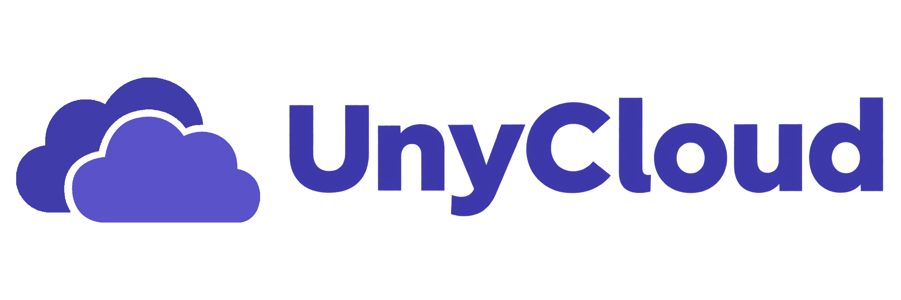
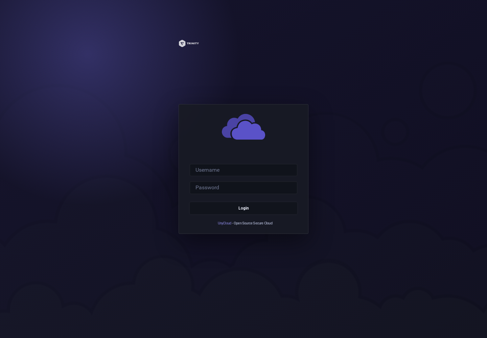

# UnyCloud
{ .project-root-logo }

## Interface actuelle

{ .unyport-screen }

- ✅ Vérifier le fichier et sa destination avant tout téléversement.
- ⭕ Un lien de partage doit être révoqué dès qu’il n’est plus nécessaire.
- ➡️ Contrôler le type de contenu renvoyé par la surface cloud :
```bash
curl -fsSI https://cloud.trinity-net.com/
```
`UnyCloud` est la surface cloud de fichiers de l'écosystème `TRINITY`. Elle expose `<cloud-domain>` comme espace de navigation, dépôt, téléchargement et partage de fichiers, tout en s'appuyant sur un fork maintenu de Filebrowser.

Publiquement, `UnyCloud` rassemble :

- Une interface web de fichiers
- Un accès authentifié aux espaces montés
- Un branding TRINITY dédié
- Un point d'entrée HTTPS derrière reverse proxy
- Une séparation claire entre produit visible et runtime Filebrowser

`UnyCloud` doit se lire comme le service cloud utilisateur. `Filebrowser` reste la lignée technique et le contrat de compatibilité documenté côté admin.

## Commencer ici
Ordre conseillé :

1. ➡️ `Introduction`
2. ➡️ `Présentation`
3. ➡️ `Architecture`
4. ➡️ `Mode d'emploi`
5. ➡️ `Accès et authentification`
6. ➡️ `Déploiement`
7. ➡️ `Sécurité et exploitation`
8. ➡️ `Exemples`
9. ➡️ `Historique`

```text
Navigateur
  -> <cloud-domain>
  -> Reverse proxy TRINITY
  -> Runtime Filebrowser
  -> Stockage monté
```
