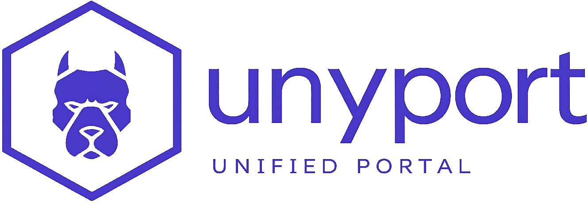

# UnyPort
- Vor jeder Aktion Host und Dienst identifizieren.
- ⭕ Proxy- oder Administrationstoken niemals offenlegen.
- ➡️ Öffentliche Verfügbarkeit prüfen:
```bash
curl -fsSI https://unyport.app/
```

{ .project-root-logo }

`UnyPort` ist die ökosystembetreiberorientierte Überwachungsfläche `TRINITY`Es ist als leichte Go-App für Alpine Linux-Umgebungen mit expliziter Xen-Wiedergabe, Live-Systemstatus, Anwendungs-Proxy-Kontrolle und täglicher Host-Überwachung konzipiert.

öffentlich, `UnyPort` führt zusammen:

- Authentifizierung des Betreiberzugangs
- Live-Sichtbarkeit auf dem Host und den Diensten
- Expliziter Xen-Kontext für Dom0- und DomU-Umgebungen
- Zugriffskontrolle auf einige interne Anwendungen wie `ttyd`
- Betriebsseiten für Sicherheit, Speicher, Netzwerk- und Systemstatus

`UnyPort` Funktioniert mit zwei komplementären Oberflächen:

- `TRINITY` Für den Customer Lifecycle, Bestellungen, Abrechnung und Service-Einstiegspunkte
- `UnyDesk` Für Remote-Zugriff und Support-Workflows

## Beginnen Sie hier
Für die praktische Lektüre ist die empfohlene Reihenfolge:

1. ➡️ `Introduction`
2. ➡️ `Architecture`
3. ➡️ `Mode d'emploi`
4. ➡️ `Accès et authentification`
5. ➡️ `Métriques et surfaces`
6. ➡️ `Déploiement`
7. ➡️ `Alpine Linux et Xen`
8. ➡️ `Sécurité et exploitation`
9. ➡️ `Exemples`

 [Durchsuchen 103 Netzwerk-Icons, Speicher und Festplatten](icon-library.md)

```text
Connexion opérateur
  -> Tableau de bord
  -> Detection du rôle de l'hôte
  -> Métriques et logs
  -> Sécurité et versions
  -> Proxy applicatif si nécessaire
  -> Réglages admin si autorisés
```

Dieser Abschnitt beschreibt daher `UnyPort` als reale Bedienoberfläche, nicht als generisches Dashboard-Theme oder als einfaches Quell-Repository.
