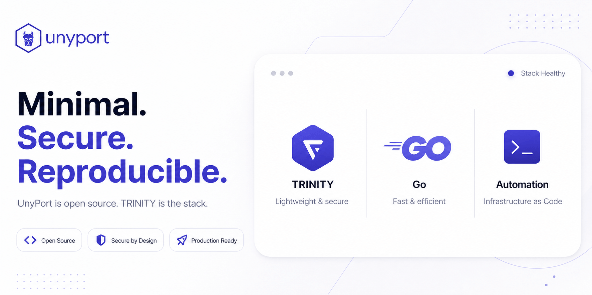

# UnyPort
- Identify the host and service before taking action.
- ⭕ Never expose a proxy or administration token.
- ➡️ Check public availability:
```bash
curl -fsSI https://unyport.app/
```

{ .unyport-screen .project-root-logo }

`UnyPort` is the ecosystem operator oriented supervision surface `TRINITY`It is built as a light Go app for Alpine Linux environments, with explicit Xen playback, live system status, application proxy control and daily host supervision.

Publicly, `UnyPort` brings together:

- Authenticated operator access
- Live visibility on the host and services
- Explicit Xen context for Dom0 and DomU environments
- Access control to some internal applications such as `ttyd`
- Operational pages for security, storage, network and system status

`UnyPort` Works with two complementary surfaces:

- `TRINITY` For customer life cycle, orders, billing and service entry points
- `UnyDesk` For remote access and support workflows

## Start here
For practical reading, the recommended order is:

1. ➡️ `Introduction`
2. ➡️ `Architecture`
3. ➡️ `Mode d'emploi`
4. ➡️ `Accès et authentification`
5. ➡️ `Métriques et surfaces`
6. ➡️ `Déploiement`
7. ➡️ `Alpine Linux et Xen`
8. ➡️ `Sécurité et exploitation`
9. ➡️ `Exemples`

 [Browse 103 network icons, storage and disks](icon-library.md)

```text
Connexion opérateur
  -> Tableau de bord
  -> Detection du rôle de l'hôte
  -> Métriques et logs
  -> Sécurité et versions
  -> Proxy applicatif si nécessaire
  -> Réglages admin si autorisés
```

This section therefore describes `UnyPort` as a real operating surface, not as a generic dashboard theme or as a simple source repository.
