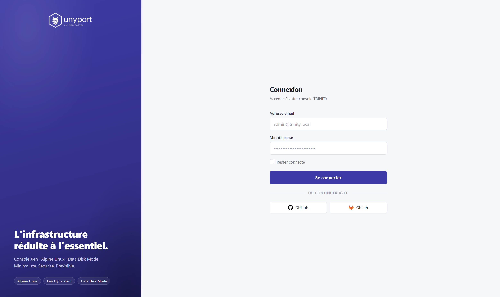
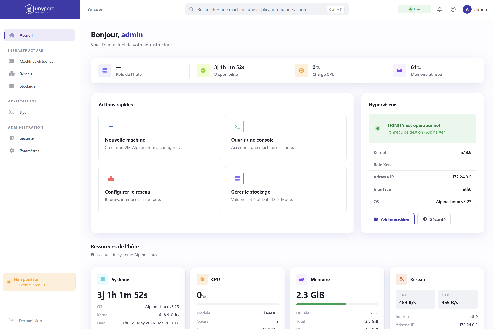
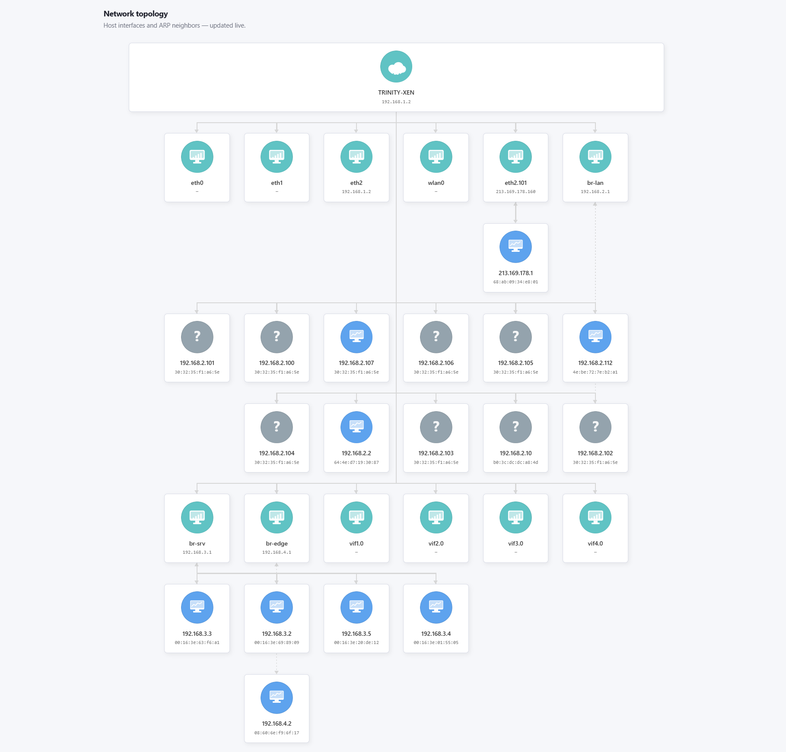

# Gebrauchsanweisung

## Sichtvermerk

{ .unyport-screen }

Nach der Authentifizierung bringt das Dashboard den Host-Status und den Zugriff auf spezialisierte Oberflächen zusammen.

{ .unyport-screen }

Die Netzwerkkarte verwendet die Netzwerkpiktogramme, um Familien von entdeckten Geräten zu unterscheiden.

{ .unyport-screen }

 [Sehen Sie sich die Legenden von Netzwerk- und Speichersets an](icon-library.md)

Diese Seite ist der bequeme Einstiegspunkt für Betreiber, die `UnyPort` Es konzentriert sich auf sichtbaren Workflow, vom ersten Login bis hin zu überwachten Aktionen.

## Normaler Bedienpfad
Der übliche Weg ist:

1. ➡️ Offene URL `UnyPort`
2. ➡️ Verbinden Sie sich mit einem lokalen oder OAuth-Konto
3. ➡️ Bestätigen Sie, dass die Hostrolle erkannt wird
4. ➡️ Lesen Sie das Dashboard und den Neustartverlauf
5. ➡️ Wechseln Sie zu Hypervisor-, Netzwerk-, Speicher- oder Sicherheitsseiten
6. ➡️ Offene proxed interne Anwendung, wenn nötig
7. ➡️ Ändern Sie das Admin-Profil oder die Einstellungen nur, wenn die Rolle es zulässt

```text
Ouvrir le portail
  -> S'authentifier
  -> Lire le rôle de l'hôte
  -> Vérifier CPU / mémoire / réseau
  -> Inspecter Xen ou LBU
  -> Lire logs ou sécurité
  -> Escalader via TRINITY ou UnyDesk si besoin
```

## Vor der ersten Verwendung
Einige Informationen müssen vorbereitet werden:

- Die richtige URL oder Return Proxy-Eintrag
- Lokaler Benutzer oder OAuth-Provider konfiguriert
- Der erwartete Hosttyp: Dom0, DomU, Container oder Alpine Host
- ⭕ Die Tatsache, dass eine interne Anwendung wie `ttyd` Muss oder darf nicht verfügbar sein

## Was das Portal ausstellen kann
Je nach Konfiguration und Rolle des Hosts, `UnyPort` kann exponieren:

- Dashboard-Zusammenfassungen
- Live-Daten CPU, Speicher und Netzwerk
- Der Zustand der Scheiben und die Persistenz LBU
- OpenRC-Dienste und einige Protokolle
- Sicherheitskontrollen und Hafenexposition
- Hypervisor-Informationen und Xen-Domains auf Dom0
- Betreiberprofil, SSH-Schlüssel und Branding-Einstellungen

## Wenn die Reise technischer wird
Der Workflow wird operativer, wenn Sie Folgendes benötigen:

- Vergleichen Sie die Alpine Version oder den laufenden Kernel mit Tags `TRINITY` Koffer
- Inspizieren Sie eine Dom0 und ihre aktiven Domains
- Überprüfen Sie, ob LBU-Änderungen vorgenommen wurden
- Überprüfung von Planted Services
- Offene Terminal-Anwendung über `/proxy/<name>/`

Die folgenden Seiten dienen als Strukturhandbuch für diese Spots.
