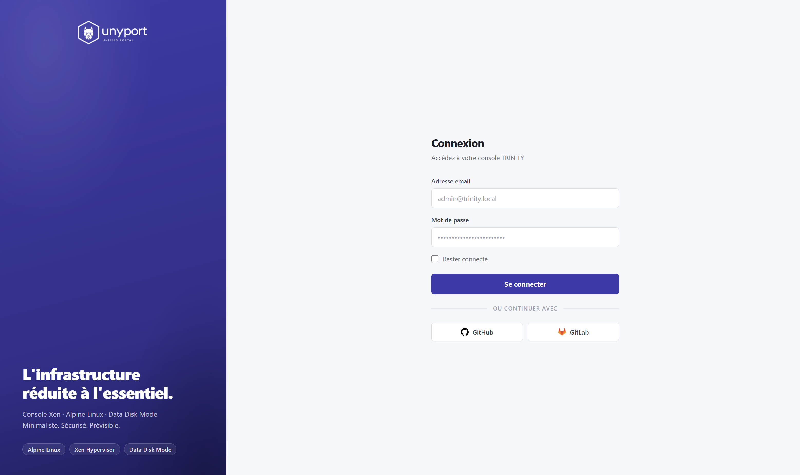
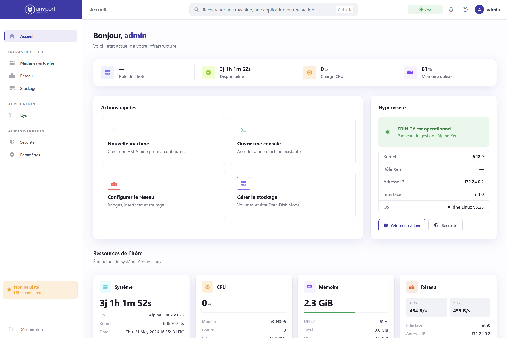
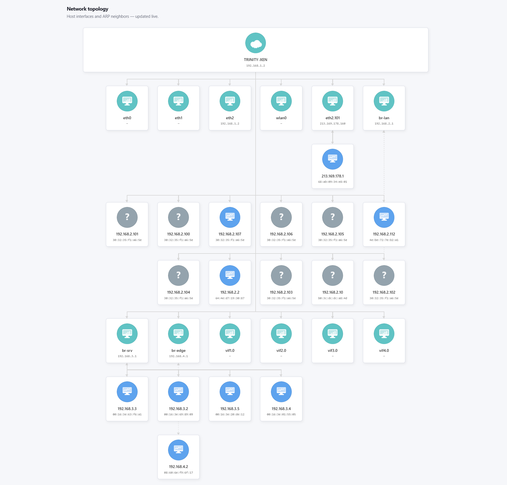

# Instructions for use

## Visual reference

{ .unyport-screen }

After authentication, the dashboard brings together the host state and access to specialized surfaces.

{ .unyport-screen }

The network card uses the network pictograms to distinguish families of equipment discovered.

{ .unyport-screen }

 [View the network and storage set legends](icon-library.md)

This page is the convenient entry point for operators who use `UnyPort` It focuses on visible workflow, from the first login to supervised actions.

## Normal operator path
The usual path is:

1. ➡️ Open URL `UnyPort`
2. ➡️ Connect with a local or OAuth account
3. ➡️ Confirm host role detects
4. ➡️ Read the dashboard and the restart history
5. ➡️ Switch to hypervisor, network, storage or security pages
6. ➡️ Open proxified internal application if needed
7. ➡️ Change admin profile or settings only if the role allows

```text
Ouvrir le portail
  -> S'authentifier
  -> Lire le rôle de l'hôte
  -> Vérifier CPU / mémoire / réseau
  -> Inspecter Xen ou LBU
  -> Lire logs ou sécurité
  -> Escalader via TRINITY ou UnyDesk si besoin
```

## Before first use
Some information needs to be prepared:

- ✅ The correct URL or return proxy entry
- ✅ A local user or OAuth provider configured
- ✅ The host type expected: Dom0, DomU, container or Alpine host
- ⭕ The fact that an internal application such as `ttyd` Must or must not be available

## What the portal can exhibit
Depending on the configuration and role of the host, `UnyPort` may expose:

- ✅ Dashboard summaries
- ✅ Live data CPU, memory and network
- ✅ The state of the discs and the persistence LBU
- ✅ OpenRC services and some logs
- ✅ Security checks and port exposure
- ✅ Hypervisor information and Xen domains on Dom0
- ✅ Operator profile, SSH key and branding settings

## When the journey becomes more technical
Workflow becomes more operational when you need:

- ✅ Compare the Alpine version or kernel in progress with tags `TRINITY` boot
- ✅ Inspect a Dom0 and its active domains
- ✅ Check if any LBU changes have been made
- ✅ Reviewing planted services
- ✅ Open terminal application via `/proxy/<name>/`

The following pages serve as a structure manual for these spots.
